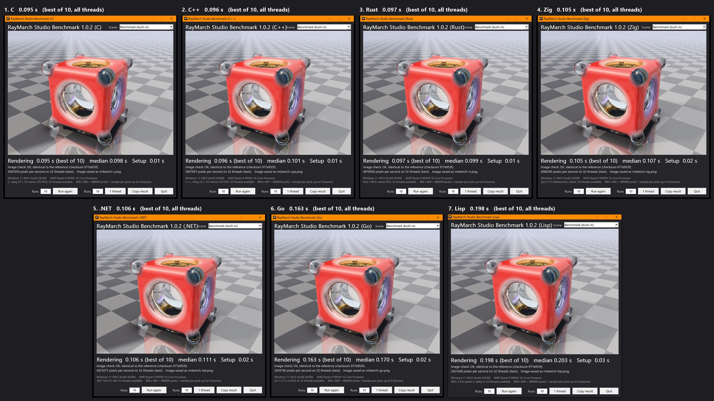
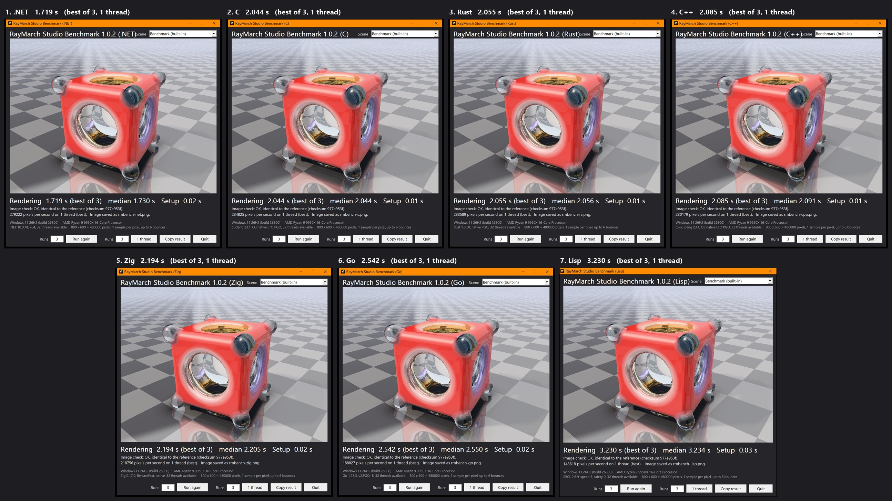

# Which programming language should you use today?

**Want to know which language to use for your programs today? Take a look
at these results.**

The RayMarch Studio Benchmark renderer was ported to seven languages: C,
C++, C#, Rust, Go and Zig, the fastest languages available today, plus a
treat for the connoisseurs, **Common Lisp**. Every version renders the same
scene with the same algorithm and produces **exactly the same image, bit for
bit**. Then each one was timed on the same PC, one after the other.

The seven ports were written by Claude (Anthropic's AI), working with the
author of RayMarch Studio, starting from the C renderer.

## All threads (32), best of 10

| # | Language | Compiler | Best | Median | vs fastest |
|---|---|---|---|---|---|
| 1 | C | clang 23.1, LTO, PGO | 0.095 s | 0.098 s | - |
| 2 | C++ | clang 23.1, LTO, PGO | 0.096 s | 0.101 s | +1% |
| 3 | Rust | Rust 1.86, LTO, PGO | 0.097 s | 0.099 s | +2% |
| 4 | Zig | Zig 0.17, ReleaseFast | 0.105 s | 0.107 s | +11% |
| 5 | C# | .NET 10, JIT | 0.106 s | 0.111 s | +12% |
| 6 | Go | Go 1.27, PGO | 0.163 s | 0.170 s | +72% |
| 7 | Common Lisp | SBCL 2.6.9 | 0.198 s | 0.203 s | +108% |

## One thread, best of 3

| # | Language | Compiler | Best | Median | vs fastest |
|---|---|---|---|---|---|
| 1 | C# | .NET 10, JIT | 1.719 s | 1.730 s | - |
| 2 | C | clang 23.1, LTO, PGO | 2.044 s | 2.044 s | +19% |
| 3 | Rust | Rust 1.86, LTO, PGO | 2.055 s | 2.056 s | +20% |
| 4 | C++ | clang 23.1, LTO, PGO | 2.085 s | 2.091 s | +21% |
| 5 | Zig | Zig 0.17, ReleaseFast | 2.194 s | 2.205 s | +28% |
| 6 | Go | Go 1.27, PGO | 2.542 s | 2.550 s | +48% |
| 7 | Common Lisp | SBCL 2.6.9 | 3.230 s | 3.234 s | +88% |

*Windows 11 26H2 (build 26300), AMD Ryzen 9 9950X (16 cores, 32
threads). Rendering time of the 800 x 600 benchmark scene.*

## What the numbers say

- **On all the threads, C, C++ and Rust are tied**: 2% between the first
  and the third, less than the noise of a 0.1 s test.
- **Zig and C# follow closely**, about 11-12% behind.
- **On one thread, C# (.NET 10) is the fastest**, almost 20% ahead of C,
  C++ and Rust. Its tiered JIT recompiles the hot code with the profile of
  the running program; on 32 threads the whole test lasts 0.1 s, which
  probably leaves the JIT less room to make the same difference.
- **Go** is 1.5 to 1.7 times slower than C.
- **Common Lisp**, compiled to native code by SBCL, runs at about half the
  speed of C. Not bad for a language from 1984, with a garbage collector
  that never has to run during the rendering.

## Why the comparison is fair

- **Same algorithm, same data, same order of the operations.** Each port
  follows the C renderer line by line: the same compact objects, the same
  interpreter for the distance field, the same lighting, glass and
  environment code.
- **The same image, bit for bit.** Every version computes the same FNV
  checksum of the 800 x 600 image (`977e953f`). The windows in the
  screenshots say "OK, identical to the reference". A port that took a
  shortcut would produce a different picture.
- **No fast math, no reordering of floating point operations, no FMA**
  (fused multiply-add) in any version. FMA would change the last bits of
  the results, and it would give an advantage only to the languages
  whose compilers use it on their own.
- **The same maths library**: `sin`, `cos`, `pow` and the others come from
  the Windows C runtime (ucrtbase) in C, C++, C#, Rust and Zig. Go uses
  its own library, and produces the same image anyway.
- **The same work scheduler**: the image is cut into 16 x 16 pixel tiles,
  and the threads take them from an atomic counter. The pixel buffer is
  aligned to the 64 byte cache line.
- **Each compiler at its best**, with the options a careful developer
  would use:

| Language | Build |
|---|---|
| C | clang 23.1, `-O3 -march=native -ffp-contract=off`, LTO, PGO |
| C++ | clang 23.1, C++20, the same options as C, LTO, PGO |
| C# | .NET 10, JIT with tiered PGO, ReadyToRun |
| Rust | Rust 1.86, `opt-level 3`, `lto = "fat"`, `codegen-units = 1`, `target-cpu=native`, PGO |
| Go | Go 1.27.3, `GOAMD64=v2`, PGO, no bounds checks (`-B`) |
| Zig | Zig 0.17, `ReleaseFast`, `-mcpu native` (Zig does no LTO or PGO on Windows) |
| Common Lisp | SBCL 2.6.9, `(speed 3) (safety 0)`, declared types, no allocation while rendering |

Go uses `GOAMD64=v2` because with v3 its compiler would turn `a * b + c`
into FMA by itself, and the image would no longer be identical.

## Limits

One renderer, one scene, one PC. The renderer is a good mix of floating
point maths, branches and memory access, but other programs can behave
differently. The best of several runs is reported because a single run
on a desktop PC is affected by everything else that runs on it.
