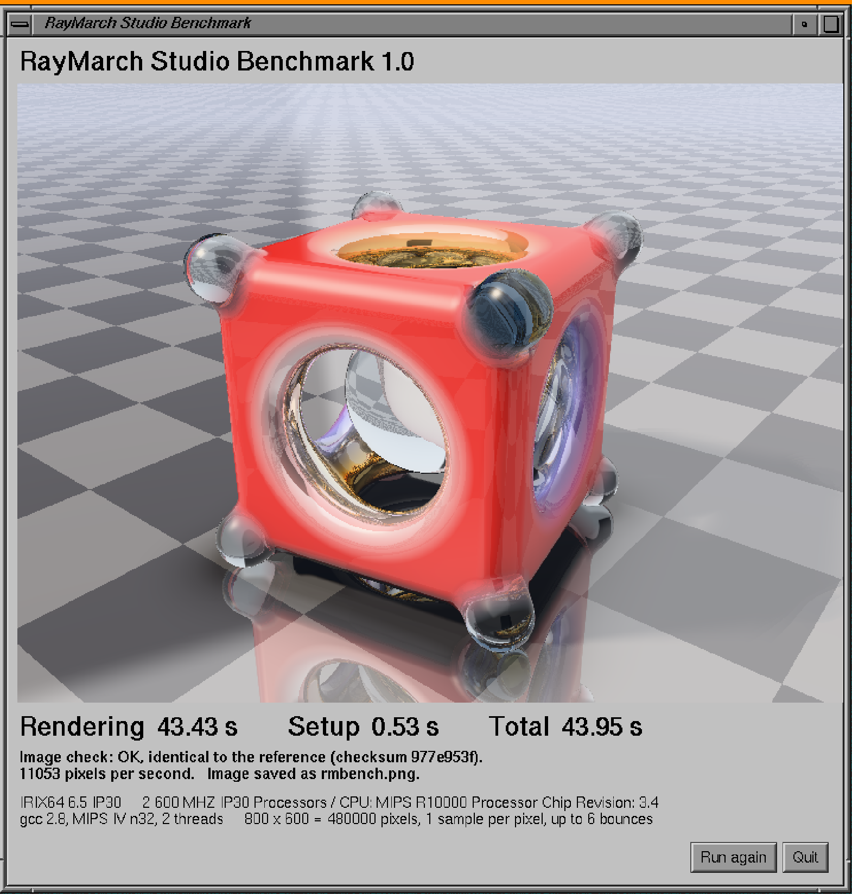

# RayMarch Studio Benchmark

A CPU rendering benchmark for **SGI workstations running IRIX**: start it,
watch the image being built in a window, and compare your machine with
others. A Windows version is included too, and macOS and Linux will
follow, so that old and new machines can be put side by side.



*Emulated Octane (SGIEmu), 2 processors at 1000 MIPS.*

## What it does

It renders one fixed scene at **800 x 600** with the renderer of RayMarch
Studio, a signed distance field (SDF) modeller. Every pixel is found by ray
marching through the distance field, in double precision, with real
reflections, refraction through glass and soft shadows. There is one
sample per pixel and up to 6 bounces.

The scene is a classic SDF showpiece. A glossy red plastic cube is carved
from the inside by a sphere and pierced by three cylinders, each one with
its own material: gold, chrome and blue plastic. The cuts are smooth, so
the materials melt into each other around every opening. Eight small dark
glass spheres are melted into the corners, and the cube stands on the
lower four. A clear glass sphere floats in the golden hollow. The floor is
reflective and the lighting is a "light tent" studio.

The rendering uses all the processors of the machine (POSIX threads).

## Running it on IRIX

Download `RayMarchStudioBenchmark-irix.tar` from the
[Releases](../../releases) page and copy it to your SGI. Then, in a
terminal on the SGI desktop:

```
tar xf RayMarchStudioBenchmark-irix.tar
cd RayMarchStudioBenchmark
bin/rmbenchx
```

Which program to run depends on your processor (`hinv -c processor` tells
you which one you have):

| Processor | Window | Command line |
|---|---|---|
| R5000, R8000, R10000, R12000, R14000, R16000 (MIPS IV) | `bin/rmbenchx` | `bin/rmbench` |
| R4000, R4400, R4600 (MIPS III) | `bin/rmbenchx.mips3` | `bin/rmbench.mips3` |

Some more details:

- The programs are built for **IRIX 6.5** (n32). They have only been
  tested on IRIX 6.5.
- `rmbenchx` opens a window. It works on 24, 16, 15 and 12 bit TrueColor
  screens; on 8 bit screens it dithers to 216 colours.
- `rmbench` is the same test without a window, for telnet or ssh.
- If the files lost their permissions on the way, run `chmod +x bin/*`.
- Run it from a directory you can write to: the image is saved there as
  `rmbench.png`.
- Close other programs first: the benchmark measures the whole machine.

Options (none are needed):

- `-t N` uses N threads. The default is all the processors; `-t 1`
  measures a single processor.
- `-n` does not save the image.

## Windows

Windows has the same benchmark with a window: the same scene, the same
800 x 600 image, the same image check. This lets you put a PC next to the
SGI machines.

Download `RayMarchStudioBenchmark-windows-x64.exe` from the
[Releases](../../releases) page and double-click it. No installation is
needed. It runs on 64 bit Windows 10 and 11.

- The window shows the image while it renders, then the Rendering, Setup
  and Total times, the image check and the speed in pixels per second.
- **Run again** renders again on all the threads.
- **1 thread** measures one processor only. This is the fairest
  comparison with an SGI processor.
- **Copy result** copies the `RESULT` line to the clipboard, ready to
  post.
- The image is saved as `rmbench.png` next to the program.

On a modern PC the whole test takes a fraction of a second on all the
threads and a few seconds on one thread. The times use the
high-resolution counter of Windows, so they are precise anyway.

`rmbench-windows-x64.exe` is the command line version (options `-t N`,
`-n`), for scripts.

## Reading the results

When it finishes, the window shows three times:

- **Rendering**: the time to compute the 480000 pixels. This is the number
  to compare between machines.
- **Setup**: the time to prepare the scene (the studio lighting).
- **Total**: the two together.

Under the times you also see the speed in pixels per second and an image
check. The image check compares the picture with the reference: the mean
colour and a checksum. "OK, identical to the reference" means that the
picture matches the reference bit for bit. "OK (last bits differ)" is
also fine: a different compiler or processor rounded a few values in
another way. "WRONG IMAGE" means that something went wrong, and that the
time does not count.

The terminal also gets one line that starts with `RESULT`, for example:

```
RESULT | rmbench 1.0 | IRIX64 6.5 IP30 | 2 600 MHZ IP30 Processors / CPU: MIPS R10000 Processor Chip Revision: 3.4 | gcc 2.8, MIPS IV n32 | 2 threads | setup 0.53 s | render 43.43 s | total 43.95 s | image identical
```

## Send your result

Copy the `RESULT` line and post it in an
[issue](../../issues) or in the SGI group. A photo of the window on your
machine is very welcome too. Results are collected in
[RESULTS.md](RESULTS.md).

## Notes

This repository contains only the programs: the source of the renderer is
not public. The programs are free to download and run.

SGI, Silicon Graphics, IRIX, Octane, Indy, Indigo, O2, Onyx, Origin, Fuel
and Tezro are trademarks of their respective owners. This project is not
affiliated with them.
