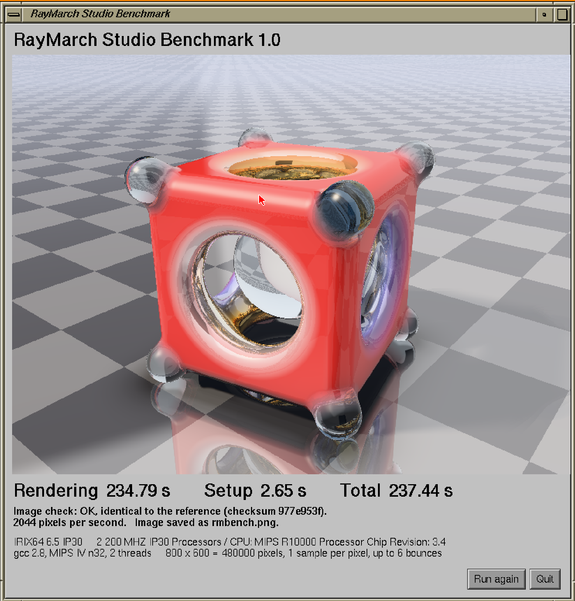
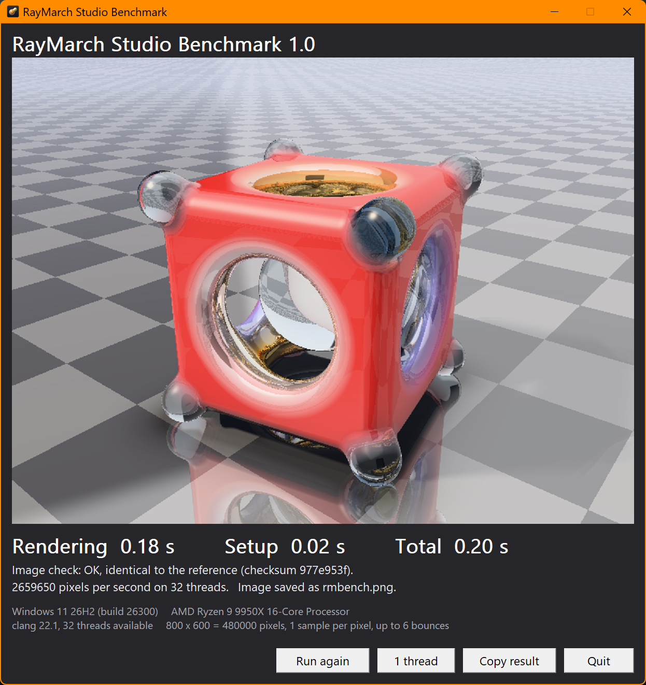

# Results

RayMarch Studio Benchmark 1.0, 800 x 600. Lower times are better; compare
the **Rendering** column.

| Machine | Processors | Program | Threads | Rendering | Setup | Total | Pixels/s | Image check |
|---|---|---|---|---|---|---|---|---|
| Octane, **emulated** (SGIEmu), IRIX 6.5 | 2 x R10000 at 1000 MIPS | rmbenchx, gcc 2.8, MIPS IV n32 | 2 | 43.43 s | 0.53 s | 43.95 s | 11053 | identical (977e953f) |
| Octane, **emulated** (SGIEmu), IRIX 6.5 | 2 x R10000 at 200 MIPS | rmbenchx, gcc 2.8, MIPS IV n32 | 2 | 234.79 s | 2.65 s | 237.44 s | 2044 | identical (977e953f) |
| PC, AMD Ryzen 9 9950X, Windows 11 | 16 cores, 32 threads | RayMarchStudioBenchmark.exe, clang 22.1, x86-64 | 32 | 0.18 s | 0.02 s | 0.20 s | 2659650 | identical (977e953f) |
| PC, AMD Ryzen 9 9950X, Windows 11 | 1 thread | RayMarchStudioBenchmark.exe, clang 22.1, x86-64 | 1 | 2.48 s | 0.02 s | 2.50 s | 193548 | identical (977e953f) |

About the emulated machine: inside an emulator, IRIX's clock advances with
the emulated instructions. The emulated times therefore show how many
instructions the test needs at the emulated speed (1000 or 200 MIPS per
processor). They do not show how fast the host computer is. The 200 MIPS
run is the emulator's guess at a dual 200 MHz Octane (`hinv` says
"200 MHZ"): it executes one instruction per clock, while a real R10000
can do more or less than that depending on the code (caches, FPU
latencies), so a real dual R10000 Octane is the result we are waiting for.
At 1000 MIPS `hinv` reports "600 MHZ", a value derived from the emulated
timer, not a real clock speed.

*Emulated Octane (SGIEmu), 2 processors at 200 MIPS, the speed of a dual
200 MHz R10000. GNOME was starting while this run was rendering, so the
time is a little pessimistic.*

Real machines: send your `RESULT` line (see the [README](README.md)) and
it will be added here.

**Under investigation**: an O2 (IP32, R12000 at 300 MHz, IRIX 6.5.22m)
renders the glass without its transparency, so its time (247 s on 1
processor) does not count yet. The image matches what the renderer gives
when the C library's `pow()` returns 0, so the suspect is the maths library
of that system. `test/fptest` checks it: see
[issue #1](../../issues/1).

*Windows 11, AMD Ryzen 9 9950X, 32 threads.*
